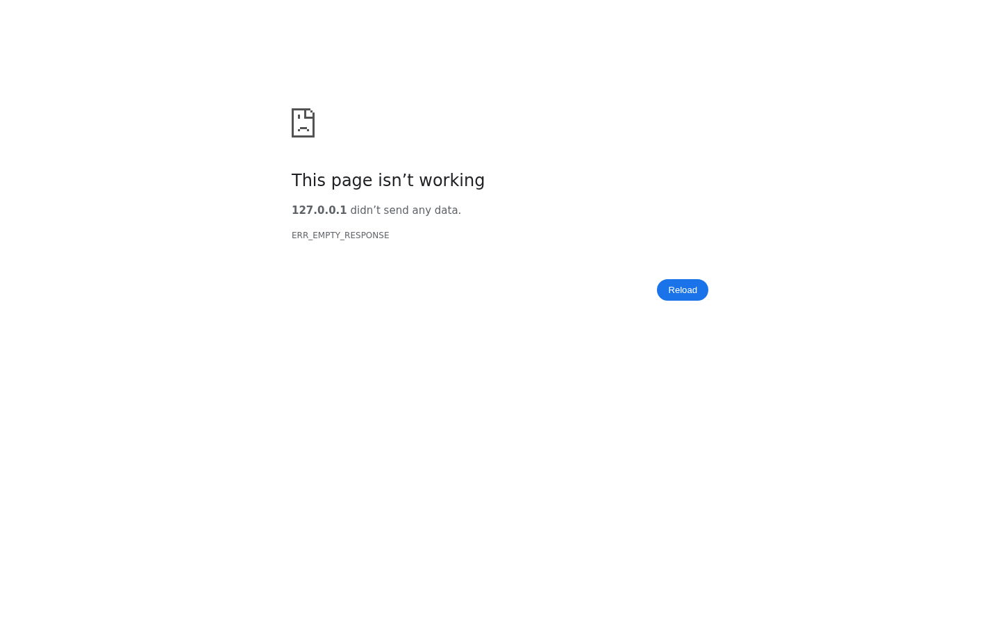

# SHIKGOO

LAN-Bestellsystem für Tablets mit WebRTC-Videoanruf zwischen Gast und Kellner. Der Server ist in reinem C (POSIX, pthreads, OpenSSL) geschrieben, das Frontend in Vanilla-JS, es wird kein Internet benötigt.


## Screenshots

| Kunde | Kellner |
|---|---|
|  |  |

## Features

- Tischauswahl (1-20), Speisekarte nach Kategorien, Warenkorb und Bestellung
- Statusverfolgung: pending, accepted, preparing, ready, delivered, bill, paid (nur vorwärts)
- Kellner-Dashboard mit Live-Queue per WebSocket, Verfügbarkeits-Schalter (frei/beschäftigt)
- Kellnerruf pro Tisch (idempotent) und Videoanruf per WebRTC (Signaling über WebSocket)
- Persistenz in `orders.json` und `calls.json` (Write-Through), Menü aus `menu.json`
- HTTPS auf Port 8443 mit Weiterleitung von Port 80, Installer für Raspberry Pi (systemd, mDNS `shikgoo.local`)
- Automatischer WebSocket-Reconnect mit Backoff im Frontend

## Tech-Stack

- Backend: C, POSIX-Sockets, pthreads, OpenSSL, [cJSON](https://github.com/DaveGamble/cJSON) (mitgeliefert)
- Frontend: HTML, CSS, Vanilla-JS (kein Build-Schritt, kein Modulsystem)
- Echtzeit: WebSocket (`/ws/notifications`), WebRTC
- Tests: Bash/curl, Python (`websockets`)

## Schnellstart

### Voraussetzungen

- C-Compiler (gcc/clang), `make`, OpenSSL-Entwicklungsdateien
- TLS-Zertifikat und Schlüssel unter `/opt/shikgoo/certs/cert.pem` und `key.pem`

### Installation und Start

```bash
git clone https://github.com/Infactionfreddy/shikgoo-video-ordering.git
cd shikgoo-video-ordering
bash build-linux.sh      # bzw. build-mac.sh
# Zertifikate bereitstellen (siehe docs/INSTALLATION.md), dann:
./web_server             # aus dem Projekt-Root starten
```

Aufruf: `https://<host>:8443` (Kunde: `/customer`, Kellner: `/waiter`). Auf dem Raspberry Pi übernimmt `sudo bash install-pi.sh` Build, Zertifikat und Service.

> hinweis: Die Build-Skripte geben `http://localhost:8080` aus. Laut Code lauscht der Server aber auf HTTPS-Port 8443.

## Konfiguration

Es gibt keine Umgebungsvariablen. Die Konfiguration erfolgt über Compile-Time-Konstanten und Dateien.

| Einstellung | Ort | Standard |
|---|---|---|
| `PORT` | `include/types.h` | 8443 |
| `HTTP_PORT` | `src/main.c` | 80 |
| `CERT_PATH` / `KEY_PATH` | `src/main.c` | `/opt/shikgoo/certs/cert.pem` / `key.pem` |
| `FRONTEND_DIR` | `include/types.h` | `frontend` (relativ zum CWD) |
| `MAX_ORDERS`, `MAX_CALLS`, `MAX_WS`, `MAX_MENU` | `include/types.h` | 1000, 200, 64, 100 |
| Speisekarte | `menu.json` | 19 Gerichte |

Details: [docs/KONFIGURATION.md](docs/KONFIGURATION.md)

## Projektstruktur

```
.
├── Makefile
├── menu.json
├── src/            # api, conn, http, logic, main, menu, state, store, ws, win_init, cJSON
├── include/        # Header (inkl. compat/ für Windows)
├── frontend/       # index, customer, waiter (HTML/CSS/JS), app.js, webrtc.js
├── tests/          # test_api.sh, test_tls.sh, WebSocket-/Signaling-Tests
├── build-*.sh, build-windows.bat, run-windows.bat
├── install-pi.sh, dev-setup-macos.sh
└── stop-*.sh / stop-windows.bat
```

## Dokumentation

- [Architektur](docs/ARCHITEKTUR.md)
- [Installation](docs/INSTALLATION.md)
- [Konfiguration](docs/KONFIGURATION.md)
- [Entwicklung](docs/ENTWICKLUNG.md)
- [API](docs/API.md)
