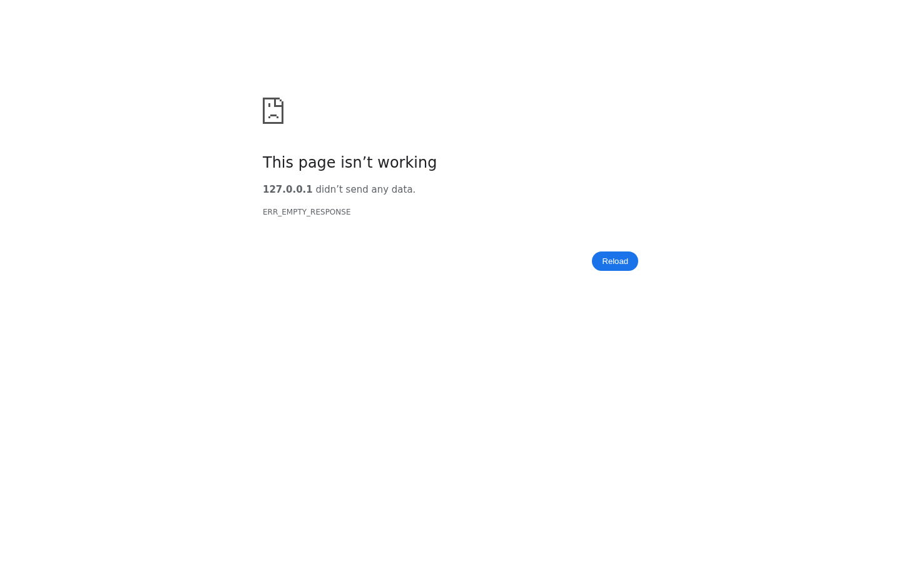
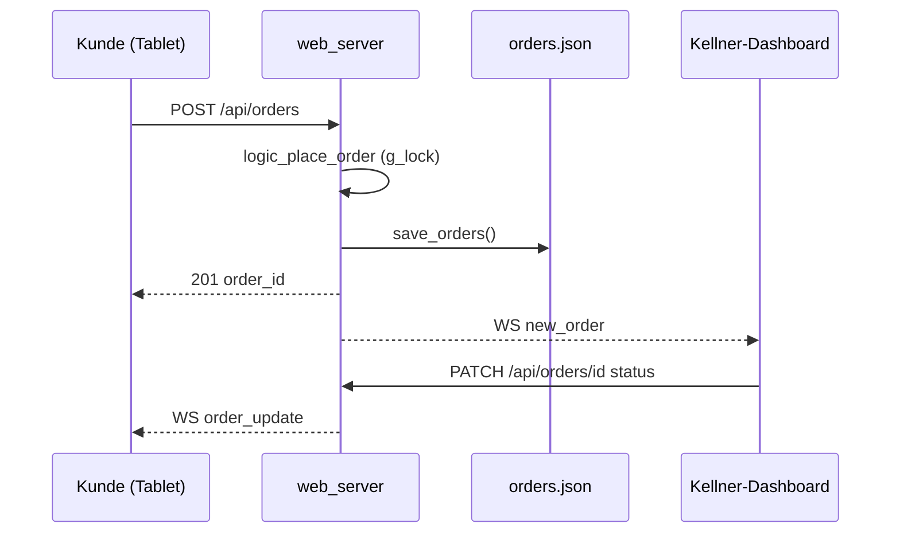
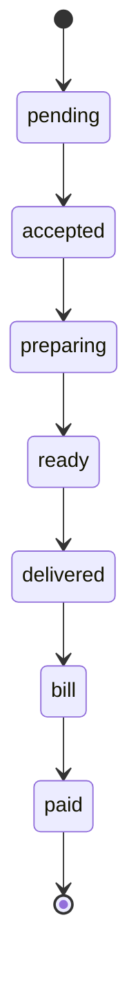
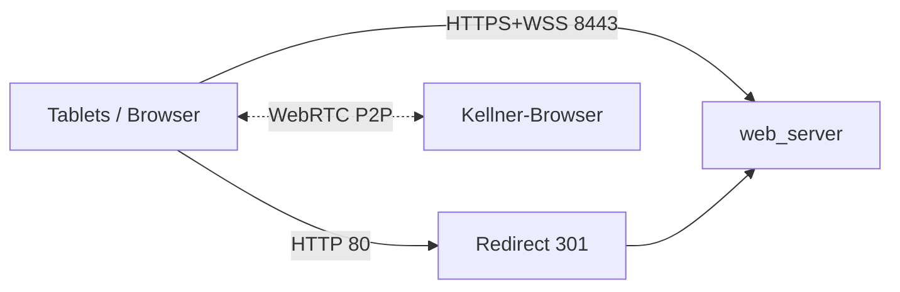

# Architektur

[Zurück zur README](../README.md)

## Überblick

SHIKGOO ist ein Single-Binary-Server (`web_server`) in C. Er liefert das Frontend statisch aus, bietet eine JSON-REST-API und einen WebSocket-Endpunkt für Live-Updates und Videocall-Signaling. Der gesamte Zustand liegt im RAM und wird nach jeder Mutation in JSON-Dateien gespiegelt.

## Komponenten

| Datei | Aufgabe |
|---|---|
| `src/main.c` | Start, TLS-Kontext, Accept-Schleife (Thread pro Verbindung), Routing, HTTP-Redirect-Thread (Port 80) |
| `src/http.c` | Request-Parser, `send_resp`, `json_resp`, statische Dateien (mit Traversal-Check, `Cache-Control: no-cache`) |
| `src/conn.c` | Einheitliche Schicht für SSL und Plain-Sockets |
| `src/api.c` | Dünne REST-Handler: Body parsen, `logic_*` aufrufen, JSON antworten, danach `ws_broadcast` |
| `src/logic.c` | Geschäftslogik und Locking (Bestellungen, Rufe, Kellnerstatus) |
| `src/store.c` | Laden/Speichern von `orders.json`, `calls.json` |
| `src/menu.c` | Laden von `menu.json` (nur beim Start) |
| `src/state.c` | Globaler Zustand und die zwei Mutexe |
| `src/ws.c` | WebSocket-Handshake, Client-Liste, Frames, Broadcast (Inhalt nicht im Detail geprüft) |
| `src/win_init.c` | Winsock-Initialisierung für Windows-Builds |
| `frontend/app.js` | Gemeinsame Helfer: WS-Reconnect, Toasts, Preisformat, Status-Labels |
| `frontend/webrtc.js` | WebRTC-Anruf (Annahme: nutzt WS-Signaling) |

## Nebenläufigkeit

- Ein Thread pro Verbindung (detached).
- `g_lock` schützt Orders, Calls, Kellnerstatus und die Call-Session; `ws_lock` schützt die WS-Clientliste. Beide dürfen nie gleichzeitig gehalten werden.
- `save_*` und `ws_broadcast` laufen nach dem Unlock.
- Pro WS-Client gibt es einen `send_lock`.

## Datenfluss

## Bestellstatus

Status geht nur vorwärts, Überspringen ist laut Code erlaubt. Bei `paid` wird die Bestellung aus dem Array entfernt und damit auch aus `orders.json`.

## Netzwerk

## Videoanruf

Genau eine `CallSession` gleichzeitig (Felder: `active`, `pending`, `caller_table`, `waiter_fd`, `customer_fd`). Der Server verwaltet die Signaling-Route zwischen Kellner- und Tisch-Socket (`ws_find_waiter`, `ws_find_table`); die Medien laufen direkt zwischen den Browsern. Annahme: kein TURN/STUN, nur LAN.

## Limits

1000 Bestellungen, 200 Rufe, 64 WS-Clients, 100 Menüeinträge, 20 Positionen je Bestellung, Menge 1-99, Tische 1-20, Request max. 8192 Byte.
